<div align="center">

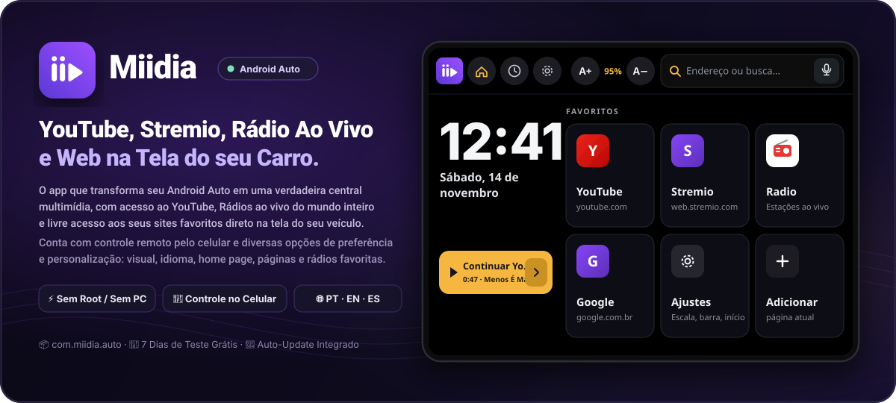

<br />

### 🌐 [**Português**](#-português) &nbsp;·&nbsp; [**English**](#-english) &nbsp;·&nbsp; [**Español**](#-español)

<br />

[-v1.11.0-7C3AED?style=for-the-badge&logo=android&logoColor=white)](https://github.com/Miidia/releases/releases/latest/download/miidia.apk)
[](https://github.com/Miidia/releases/releases)
[](#)
[](#)

</div>

---

<a id="-português"></a>

# 🇧🇷 Português

**Miidia** é um navegador de mídia completo projetado especificamente para o **Android Auto**. Assista a vídeos do **YouTube**, **Stremio**, ouça **Rádios ao vivo do mundo inteiro** e acesse seus **sites favoritos** diretamente na multimídia do seu veículo e no painel de instrumentos (**Virtual Cockpit**), com interface automotiva dedicada, controle remoto pelo celular e **ativação automática sem precisar de Root, PC ou Shizuku**.

### ⬇️ Download Direto
👉 **[Baixar a última versão · Download latest (`miidia.apk`)](https://github.com/Miidia/releases/releases/latest/download/miidia.apk)**

---

## ✨ Principais Recursos

| Recurso | Descrição |
| :--- | :--- |
| 🎬 **YouTube & Stremio Otimizados** | Layout adaptado para telas automotivas (incluindo telas *ultrawide* com lista lateral de vídeos), suporte a tela cheia, avanço/retrocesso rápido (±10s), retomada automática de onde o vídeo parou e ajuste da barra inferior (*Normal*, *Compacta* ou *Só ícones*). |
| 📻 **Rádio Ao Vivo Mundial** | Milhares de estações de rádio ao vivo integradas (via *Radio Browser*), organizadas por país, popularidade ou busca por gênero/nome, com suporte aos comandos de volante (⏮ ⏯ ⏭) e favoritos. |
| 🌐 **Navegador Web & Favoritos** | Adicione qualquer site aos seus favoritos (ex.: Twitch, canais de TV, portais), fixe até **2 atalhos rápidos (⭐)** na barra superior do Android Auto e acesse seu histórico recente com um toque. |
| 📱 **Controle pelo Celular & Cast** | Use o modo **"Navegar pelo celular"** ou **"Controle do YouTube"** para pesquisar vídeos confortavelmente no smartphone e enviá-los instantaneamente para a tela do carro (com opção *Follow* automática). |
| 🎛️ **Virtual Cockpit (Cluster)** | Compatível com o painel de instrumentos digital do veículo: exibe relógio + faixa em reprodução (*Now Playing*) e permite enviar o vídeo do YouTube diretamente para o Cockpit com ajuste de escala (70% a 155%). |
| 🔊 **Sincronização Fina de Áudio** | Elimine o atraso do Bluetooth do carro! Ajuste o *offset* de áudio/vídeo de **-500 ms a +500 ms** (em passos de 10 ms) com vídeo de teste de sincronia labial integrado. |
| 🎨 **Visuais Automotivos & Temas** | Escolha entre os visuais **Cluster** (painel escuro de alto contraste pensado para leitura rápida no carro) e **Ondas / Wave** (modo claro de dia e escuro à noite sincronizado com os faróis do veículo), além de **6 cores de destaque** (*Vermelho, Azul, Verde, Violeta, Laranja e Cinza*) e zoom de página de **60% a 150%**. |
| ⚡ **Auto-Ativação & Auto-Update** | Sem complicações técnicas: o próprio Miidia habilita sua compatibilidade com o Android Auto na primeira abertura e busca atualizações diretamente deste repositório mantendo o app sempre ativo no veículo. |

---

## 📲 Guia de Instalação Passo a Passo (15 Telas)

Você **não precisa de computador, ADB, Shizuku nem Root**. Como o Miidia é instalado fora da Play Store e precisa habilitar o reconhecimento nativo no **Android Auto**, siga os **15 passos ilustrados** abaixo (leva menos de 1 minuto!):

### Parte 1 — Download e Primeira Instalação (Passos 1 a 6)

<table>
  <tr>
    <td align="center" width="33%" valign="top">
      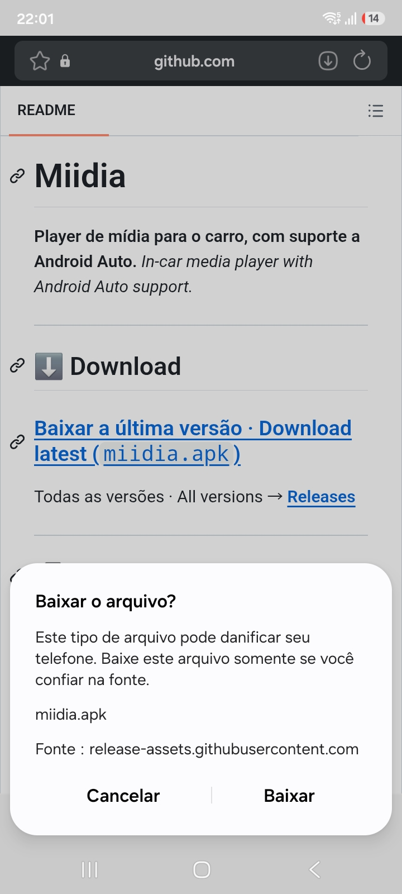<br />
      <b>Passo 1 — Confirmar Download</b><br />
      <sub>Toque no link de download do <code>miidia.apk</code> e confirme tocando em <b>Baixar</b> no aviso do navegador.</sub>
    </td>
    <td align="center" width="33%" valign="top">
      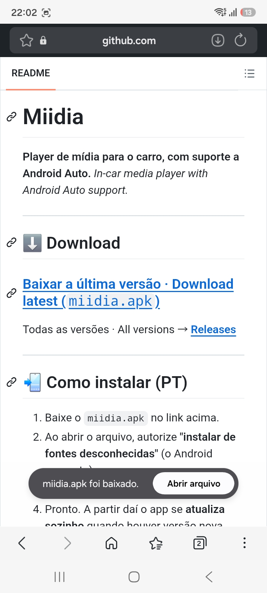<br />
      <b>Passo 2 — Abrir o Arquivo</b><br />
      <sub>Assim que o download terminar, toque em <b>Abrir arquivo</b> na notificação na parte inferior da tela.</sub>
    </td>
    <td align="center" width="33%" valign="top">
      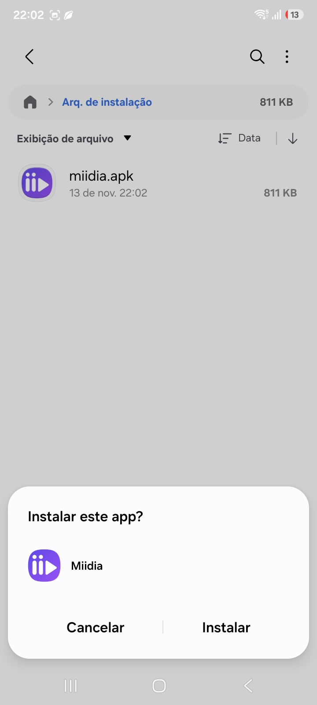<br />
      <b>Passo 3 — Iniciar Instalação</b><br />
      <sub>Na janela do instalador do Android que surgir, toque em <b>Instalar</b>.</sub>
    </td>
  </tr>
  <tr>
    <td align="center" width="33%" valign="top">
      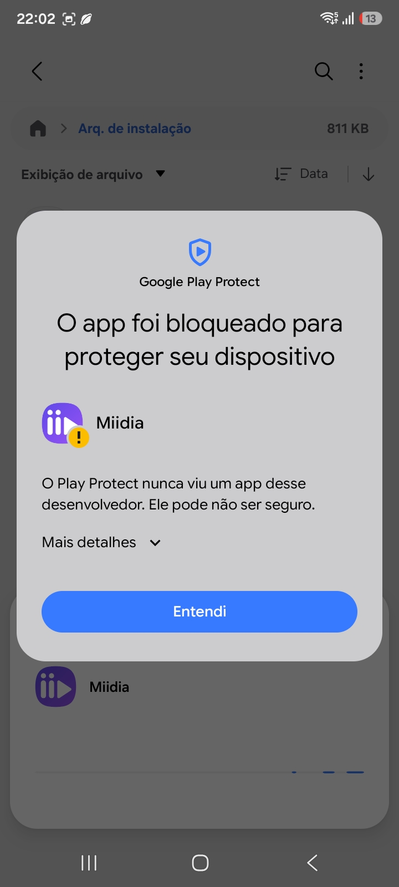<br />
      <b>Passo 4 — Aviso do Play Protect</b><br />
      <sub>Como o APK vem direto do GitHub, o Play Protect exibirá um alerta padrão. <b>Não toque em Entendi</b>: toque em <b>Mais detalhes ⌄</b>.</sub>
    </td>
    <td align="center" width="33%" valign="top">
      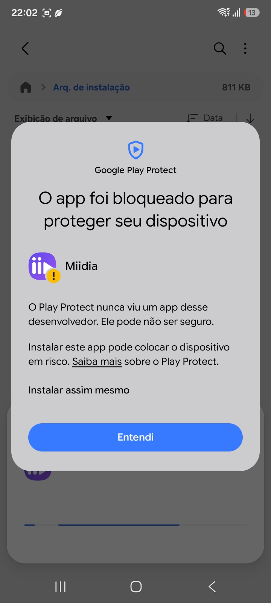<br />
      <b>Passo 5 — Instalar Assim Mesmo</b><br />
      <sub>No texto expandido, toque na opção <b>Instalar assim mesmo</b> para prosseguir com a instalação.</sub>
    </td>
    <td align="center" width="33%" valign="top">
      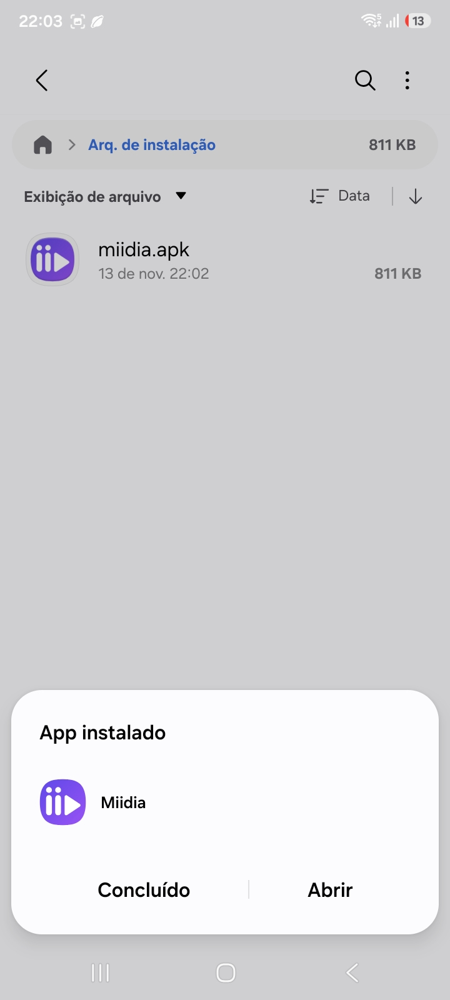<br />
      <b>Passo 6 — Abrir o Miidia</b><br />
      <sub>Com a primeira instalação concluída (<i>"App instalado"</i>), toque em <b>Abrir</b>.</sub>
    </td>
  </tr>
</table>

### Parte 2 — Permissões e Ativação no Android Auto (Passos 7 a 12)

<table>
  <tr>
    <td align="center" width="33%" valign="top">
      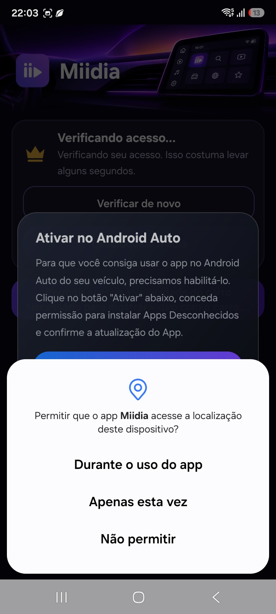<br />
      <b>Passo 7 — Permissão de Velocidade</b><br />
      <sub>Toque em <b>Durante o uso do app</b> para permitir que o Miidia identifique quando o veículo está estacionado.</sub>
    </td>
    <td align="center" width="33%" valign="top">
      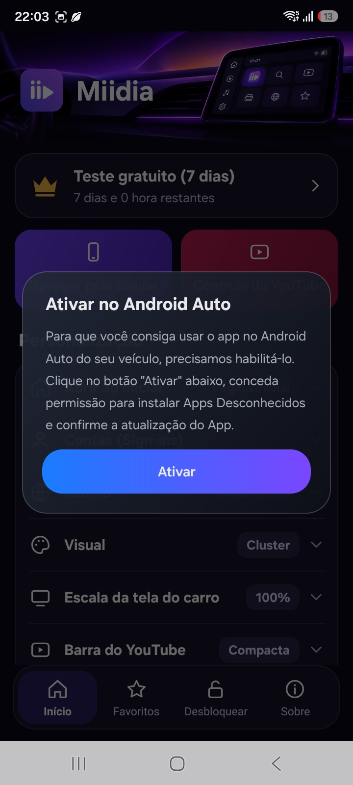<br />
      <b>Passo 8 — Ativar no Android Auto</b><br />
      <sub>Para que o carro reconheça o app, o Miidia mostrará o cartão <i>"Ativar no Android Auto"</i>. Toque no botão roxo <b>Ativar</b>.</sub>
    </td>
    <td align="center" width="33%" valign="top">
      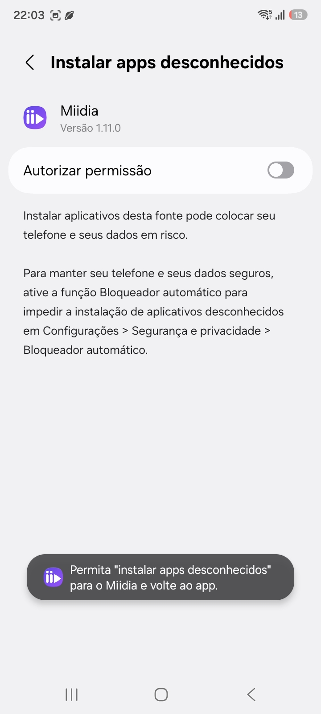<br />
      <b>Passo 9 — Tela de Permissão</b><br />
      <sub>O Android abrirá a tela <i>"Instalar apps desconhecidos"</i> para o Miidia.</sub>
    </td>
  </tr>
  <tr>
    <td align="center" width="33%" valign="top">
      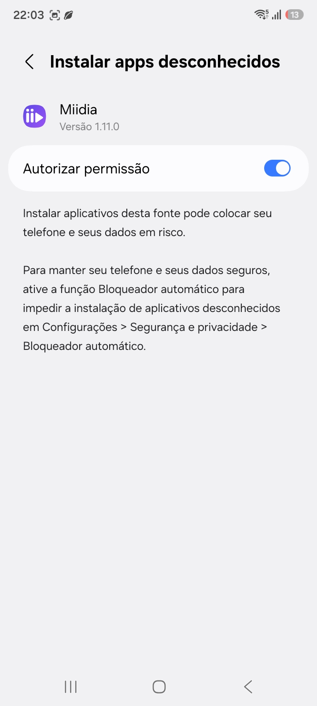<br />
      <b>Passo 10 — Autorizar e Voltar</b><br />
      <sub>Ligue a chave <b>Autorizar permissão</b> e toque no botão <b>Voltar (‹)</b> para retornar ao Miidia.</sub>
    </td>
    <td align="center" width="33%" valign="top">
      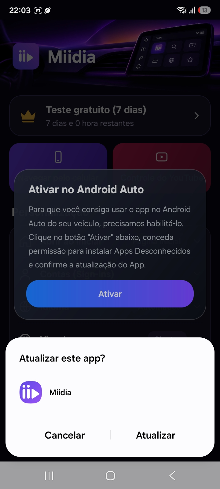<br />
      <b>Passo 11 — Confirmar Atualização</b><br />
      <sub>Ao voltar, o Miidia iniciará automaticamente a ativação. Toque em <b>Atualizar</b> no diálogo na parte inferior.</sub>
    </td>
    <td align="center" width="33%" valign="top">
      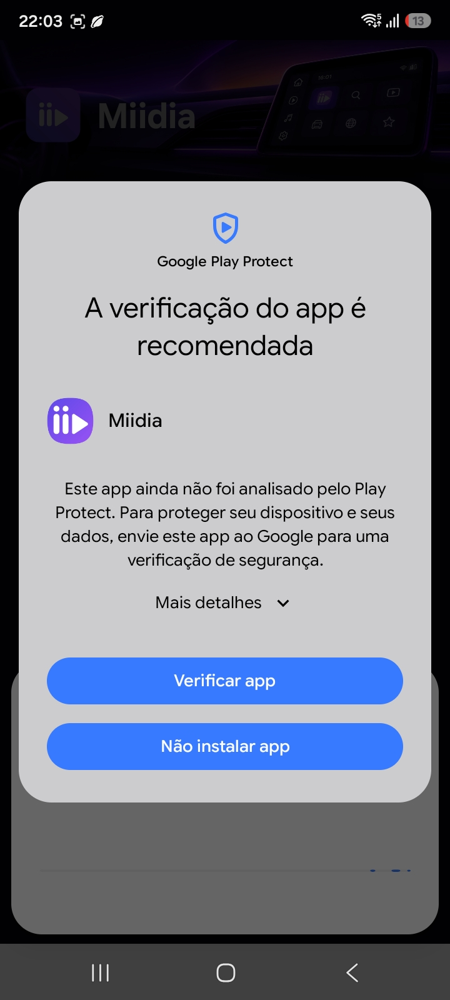<br />
      <b>Passo 12 — Mais Detalhes na Verificação</b><br />
      <sub>Se o Play Protect exibir <i>"A verificação do app é recomendada"</i>, toque novamente em <b>Mais detalhes ⌄</b>.</sub>
    </td>
  </tr>
</table>

### Parte 3 — Finalização e App Liberado (Passos 13 a 15)

<table>
  <tr>
    <td align="center" width="33%" valign="top">
      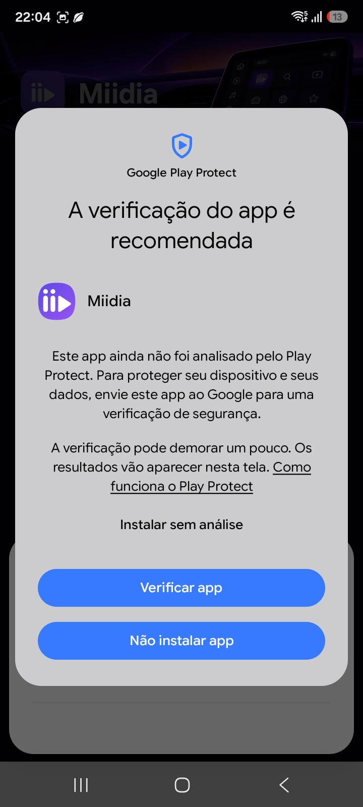<br />
      <b>Passo 13 — Instalar sem Análise</b><br />
      <sub>Toque em <b>Instalar sem análise</b> (ou <i>Verificar app</i>) para concluir a ativação.</sub>
    </td>
    <td align="center" width="33%" valign="top">
      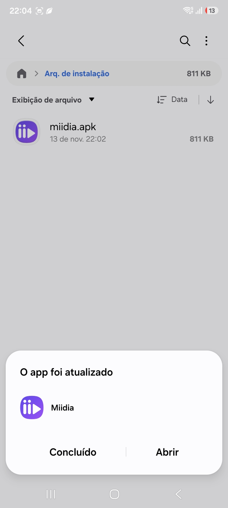<br />
      <b>Passo 14 — App Atualizado e Ativado</b><br />
      <sub>Pronto! A mensagem <i>"O app foi atualizado"</i> confirma que o vínculo com o Android Auto foi gravado. Toque em <b>Abrir</b>.</sub>
    </td>
    <td align="center" width="33%" valign="top">
      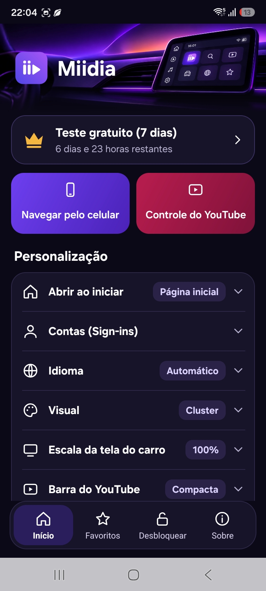<br />
      <b>Passo 15 — Tudo Pronto! 🎉</b><br />
      <sub>O Miidia abrirá liberado com todas as opções de personalização e já aparecerá na tela do Android Auto do seu veículo!</sub>
    </td>
  </tr>
</table>

> 🔄 **Como atualizar quando sair versão nova?**
> A partir de agora você não precisa mais baixar pelo navegador: no celular, abra o Miidia → toque na aba **Sobre** (barra inferior) → toque em **Verificar atualização**. O app baixa e instala sozinho mantendo o Android Auto ativo!

---

## 🔑 Teste Gratuito e Licenciamento

- ** Avaliação Gratuita:** O período de teste gratuito começa automaticamente na primeira vez que o aplicativo se conecta. Reinstalar ou atualizar o app não reinicia nem perde o seu período de teste.
- **Funcionamento Offline:** Após verificado, o app funciona mesmo sem sinal de internet na estrada (até 24h em modo avaliação e até **7 dias offline** com licença ativa, renovando automaticamente sempre que houver conexão).
- **Como Desbloquear / Comprar Licença:**
  No aplicativo do celular, abra a aba **Desbloquear / Licença** na barra inferior e toque em **Comprar licença** para ver os canais oficiais de atendimento (**E-mail** e **Telegram**), ou toque em **Ativar ou restaurar licença** caso já possua sua chave `MIID-XXXX-XXXX-XXXX-XXXX`.

---

## 🛡️ Verificação de Segurança e Assinatura Oficial

Este repositório hospeda exclusivamente os binários oficiais de distribuição e o manifesto de auto-atualização (`version.json`) do **Miidia**. Todos os APKs oficiais são assinados com a chave privada de lançamento do projeto:

```text
Proprietário : CN=James M, OU=Miidia, O=Miidia, L=Brazil, ST=Sao Paulo, C=BR
SHA-256      : 216e29208743d7ab52ff2b71da9e1ab3dfbd97a836c6dbed97c267e505d3788d
Pacote       : com.miidia.auto
```

---

## ❓ Perguntas Frequentes (FAQ)

<details>
<summary><b>Por que o Miidia pede para "atualizar" a si mesmo na primeira abertura (Passos 8 a 14)?</b></summary>
<br />
O Android Auto exige que aplicativos instalados fora da Play Store declarem origem de instalação compatível para aparecerem no painel do carro. Na primeira abertura, o Miidia faz uma auto-reinstalação rápida aplicando essa compatibilidade automaticamente — dispensando aplicativos externos, cabos no PC ou Shizuku.
</details>

<details>
<summary><b>O som do vídeo está atrasado em relação à imagem no Bluetooth do carro. Como resolver?</b></summary>
<br />
Abra o Miidia no celular → seção <b>Personalização</b> → <b>Sincronização de áudio</b>. Toque em <i>"Fazer teste de sincronia no carro"</i> e ajuste o controle deslizante (+ ou − em passos de 10 ms) até que o som coincida perfeitamente com a imagem.
</details>

<details>
<summary><b>Como fazer login na minha conta do YouTube ou Stremio?</b></summary>
<br />
Por segurança e praticidade, as senhas são digitadas no celular: abra o Miidia no smartphone → <b>Personalização</b> → <b>Contas (Sign-ins)</b> → toque em <b>Entrar</b> ao lado do YouTube, Stremio ou do seu site favorito. Sua sessão será compartilhada automaticamente com a tela do carro.
</details>

<br />

---

<a id="-english"></a>

# 🇺🇸 English

**Miidia** is a full-featured media browser purpose-built for **Android Auto**. Watch **YouTube**, **Stremio**, listen to **live radio stations worldwide**, and browse your **favorite websites** right on your car's infotainment screen and digital instrument cluster (**Virtual Cockpit**) — featuring a dedicated automotive UI, phone remote control, and **one-tap self-activation with no Root, PC, or Shizuku required**.

### ⬇️ Direct Download
👉 **[Download latest version (`miidia.apk`)](https://github.com/Miidia/releases/releases/latest/download/miidia.apk)**

---

## ✨ Key Features

| Feature | Description |
| :--- | :--- |
| 🎬 **Car-Ready YouTube & Stremio** | Custom automotive layouts (including side-by-side video lists on ultrawide screens), fullscreen video, ±10s quick seek, automatic playback resume, and customizable YouTube bottom bar (*Normal*, *Compact*, or *Icons only*). |
| 📻 **World Live Radio** | Thousands of live radio stations (powered by *Radio Browser*), filterable by country, popularity, name, or genre, with full steering-wheel media button support (⏮ ⏯ ⏭) and station favorites. |
| 🌐 **Web Browser & Favorites** | Add any website to your car home screen (e.g., Twitch, live TV, web portals), pin up to **2 quick shortcuts (⭐)** to the Android Auto top bar, and jump back into your recent browsing history. |
| 📱 **Phone Remote & Cast** | Use **"Browse from phone"** or **"YouTube remote"** to search and pick videos comfortably on your phone and beam them straight to the car screen (with optional auto-follow). |
| 🎛️ **Virtual Cockpit (Cluster)** | Supports your vehicle's digital instrument cluster: displays a clock + *Now Playing* progress panel, and can play YouTube videos directly inside the cluster with adjustable video sizing (70% to 155%). |
| 🔊 **Bluetooth Audio Sync** | Fix car Bluetooth lag effortlessly! Fine-tune audio/video offset from **-500 ms to +500 ms** (in 10 ms steps) using the built-in in-car lip-sync test video. |
| 🎨 **Automotive Looks & Themes** | Switch between **Cluster** (high-contrast dark dashboard look) and **Wave** (light by day, soft dark by night, synced with your car's headlights), plus **6 accent themes** (*Red, Blue, Green, Violet, Orange, Gray*) and **60%–150%** screen scaling. |
| ⚡ **Self-Activation & Auto-Update** | Zero tinkering: Miidia enables its own Android Auto compatibility on first launch and checks this repository for updates so your app stays recognized by Android Auto across updates. |

---

## 📲 Step-by-Step Installation Guide (15 Screens)

Follow the 15 visual screenshots above (under [Guia de Instalação Passo a Passo](#-guia-de-instalação-passo-a-passo-15-telas)):

1. **Step 1:** Tap the download link for `miidia.apk` and confirm by tapping **Download** (*Baixar*).
2. **Step 2:** Once downloaded, tap **Open file** (*Abrir arquivo*) in your browser notification.
3. **Step 3:** When prompted by the Android installer, tap **Install** (*Instalar*).
4. **Step 4:** On the Google Play Protect prompt, tap **More details ⌄** (*Mais detalhes*).
5. **Step 5:** Tap **Install anyway** (*Instalar assim mesmo*).
6. **Step 6:** Once installed, tap **Open** (*Abrir*).
7. **Step 7:** Grant location/car speed permission by choosing **While using the app** (*Durante o uso do app*) so Miidia knows when your car is parked.
8. **Step 8:** On the *"Enable in Android Auto"* prompt, tap the purple **Enable** (*Ativar*) button.
9. **Step 9:** Android will open the *"Install unknown apps"* settings page for Miidia.
10. **Step 10:** Toggle **Allow permission** (*Autorizar permissão*) ON and tap the **Back (‹)** arrow to return to Miidia.
11. **Step 11:** Miidia will automatically trigger a self-update to register with Android Auto. Tap **Update** (*Atualizar*).
12. **Step 12:** If Play Protect asks to scan the app, tap **More details ⌄** (*Mais detalhes*).
13. **Step 13:** Tap **Install without scanning** (*Instalar sem análise*).
14. **Step 14:** When *"App updated"* appears, tap **Open** (*Abrir*).
15. **Step 15:** **All done! 🎉** Miidia is now unlocked and ready in your vehicle's Android Auto launcher!

<br />

---

<a id="-español"></a>

# 🇪🇸 Español

**Miidia** es un navegador multimedia completo diseñado específicamente para **Android Auto**. Disfruta de **YouTube**, **Stremio**, **emisoras de radio en vivo de todo el mundo** y tus **sitios web favoritos** directamente en la pantalla de tu coche y en el cuadro de instrumentos digital (**Virtual Cockpit**), con interfaz automotriz dedicada, control remoto desde el móvil y **activación directa en 1 toque sin Root, PC ni Shizuku**.

### ⬇️ Descarga Directa
👉 **[Descargar la última versión (`miidia.apk`)](https://github.com/Miidia/releases/releases/latest/download/miidia.apk)**

---

## ✨ Características Principales

| Función | Descripción |
| :--- | :--- |
| 🎬 **YouTube y Stremio para Coche** | Interfaz adaptada a pantallas de coche (incluyendo pantallas *ultrawide* con lista lateral), pantalla completa, avance/retroceso rápido (±10s), reanudación automática de vídeos y ajuste de la barra inferior de YouTube (*Normal*, *Compacta* o *Solo iconos*). |
| 📻 **Radio Mundial en Vivo** | Miles de emisoras en directo (*Radio Browser*) filtradas por país, popularidad, nombre o género, con soporte para los controles del volante (⏮ ⏯ ⏭) y emisoras favoritas. |
| 🌐 **Navegador Web y Favoritos** | Añade cualquier sitio web a la pantalla de inicio del coche (ej. Twitch, TV en vivo, portales), fija hasta **2 accesos directos (⭐)** en la barra superior de Android Auto y consulta tu historial reciente. |
| 📱 **Control desde el Móvil** | Usa **"Navegar desde el móvil"** o **"Control de YouTube"** para buscar vídeos cómodamente en el teléfono y enviarlos al instante a la pantalla del coche. |
| 🎛️ **Virtual Cockpit (Cluster)** | Compatible con el cuadro de instrumentos digital del vehículo: muestra reloj + reproducción actual y permite enviar vídeos de YouTube al Cockpit con ajuste de tamaño (70% a 155%). |
| 🔊 **Sincronización de Audio** | Corrige el retraso del Bluetooth del coche ajustando el audio entre **-500 ms y +500 ms** (en pasos de 10 ms) con prueba de sincronía en tiempo real. |
| 🎨 **Diseño Automotriz y Temas** | Elige entre los estilos **Cluster** (panel oscuro de alto contraste) y **Olas / Wave** (claro de día y oscuro de noche automático), **6 colores de tema** y escala de pantalla del **60% al 150%**. |
| ⚡ **Auto-Activación y Auto-Update** | Sin configuraciones complejas: Miidia se habilita para Android Auto en la primera apertura y se actualiza directamente desde la pestaña *Acerca de*. |

---

## 📲 Guía de Instalación Paso a Paso (15 Pantallas)

Sigue las 15 capturas ilustradas más arriba (en [Guia de Instalação Passo a Passo](#-guia-de-instalação-passo-a-passo-15-telas)):

1. **Paso 1:** Toca el enlace de descarga de `miidia.apk` y confirma tocando **Descargar** (*Baixar*).
2. **Paso 2:** Al finalizar la descarga, toca **Abrir archivo** (*Abrir arquivo*) en el aviso inferior.
3. **Paso 3:** En el instalador de Android, toca **Instalar**.
4. **Paso 4:** En el aviso de Google Play Protect, toca **Más detalles ⌄** (*Mais detalhes*).
5. **Paso 5:** Toca **Instalar de todas formas** (*Instalar assim mesmo*).
6. **Paso 6:** Una vez instalada la app, toca **Abrir**.
7. **Paso 7:** Concede el permiso de ubicación/velocidad del coche eligiendo **Mientras la app está en uso** (*Durante o uso do app*).
8. **Paso 8:** En la tarjeta *"Activar en Android Auto"*, toca el botón morado **Activar**.
9. **Paso 9:** Se abrirá la pantalla *"Instalar apps desconocidas"* para Miidia.
10. **Paso 10:** Activa el interruptor **Autorizar permiso** (*Autorizar permissão*) y toca la flecha **Atrás (‹)** para volver a Miidia.
11. **Paso 11:** Miidia iniciará automáticamente su activación para Android Auto. Toca **Actualizar** (*Atualizar*).
12. **Paso 12:** Si Play Protect sugiere verificar la app, toca **Más detalles ⌄** (*Mais detalhes*).
13. **Paso 13:** Toca **Instalar sin analizar** (*Instalar sem análise*).
14. **Paso 14:** Cuando aparezca *"Se actualizó la app"*, toca **Abrir**.
15. **Paso 15:** **¡Todo listo! 🎉** Miidia ya está desbloqueada y aparecerá en el Android Auto de tu vehículo.

---

<div align="center">
  <br />
  
  <p><b>Miidia for Android Auto</b> · <code>com.miidia.auto</code></p>
  <p><sub>Distribuído oficialmente via <a href="https://github.com/Miidia/releases">github.com/Miidia/releases</a></sub></p>
</div>
